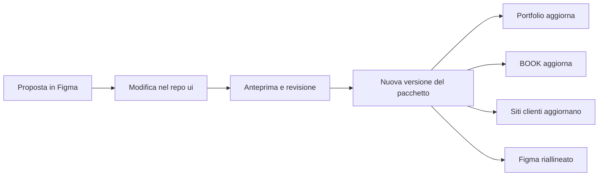

# Come una modifica al design system arriva sui siti

Guida per chi disegna. Spiega cosa succede tra il momento in cui cambi qualcosa in Figma e il momento in cui lo vedi online sul portfolio, su BOOK e sugli altri siti Alpwise.

## In breve

Il design system vive in tre posti:

| Dove | Cos'è | Chi lo tocca |
|---|---|---|
| **Figma**, file [Alpwise](https://www.figma.com/design/OepimuBopmVrYOxu38UiDH/Alpwise) | Il disegno: variabili, stili di testo, componenti, sezioni | Designer |
| **Repo `ui`** ([alpwisestudio/ui](https://github.com/alpwisestudio/ui)) | Il codice del design system, pubblicato come pacchetto `@alpwisestudio/ui` | Sviluppo |
| **I progetti che lo usano** | Portfolio (alpwise.studio), BOOK (book.alpwise.studio), siti dei clienti | Sviluppo |

La regola da ricordare: **la versione vera è quella nel codice**. Figma è dove si progetta e si propone. Una modifica esiste davvero quando è pubblicata in una nuova versione del pacchetto `ui`. Dopo, Figma viene riallineato a quella versione.

E una seconda regola: **i siti non si aggiornano da soli**. Ogni progetto decide quando passare alla nuova versione del pacchetto. Finché non lo fa, resta com'era.

## Il flusso, passo per passo

### 1. Proponi in Figma

- Lavora su una pagina **Proposte** (o su un branch del file, se il piano Figma lo consente), non direttamente sui componenti della pagina *Components*. Quella pagina deve corrispondere sempre a ciò che è online.
- Usa le variabili esistenti (collezioni *Primitives*, *Color*, *Spacing*, *Radius*) e gli stili di testo. Niente colori o misure scritti a mano: nel codice ogni valore è una variabile, e un valore fuori dal sistema non ha dove andare.
- Disegna sempre **entrambi i temi** (la collezione *Color* ha i modi *Dark*, il default, e *Light*) e, per i componenti, tutti gli stati: normale, hover, focus, disabilitato, errore.
- Pensa al **mobile**: BOOK si usa soprattutto dal telefono.

### 2. Passa la proposta allo sviluppo

Manda il link al frame con una nota breve:

- **cosa** cambia (es. "il bottone primario passa da 2px a 4px di raggio");
- **perché** (serve a capire se è una correzione o una scelta nuova);
- **dove** si vede (tutti i siti o solo uno);
- se **sostituisce** o **elimina** qualcosa che esiste già (vedi più sotto: cambia molto l'impatto).

### 3. Lo sviluppo modifica il repo `ui`

Lo sviluppo traduce la proposta nel codice: variabili CSS in `styles/tokens.css`, componenti in `src/`. Ogni variabile di Figma ha il suo nome in codice (nel pannello della variabile, *code syntax*, es. `var(--primary)`), quindi una modifica a una variabile si riporta uno a uno.

### 4. Rivedi l'anteprima

Il repo `ui` ha una pagina di anteprima con tutti i componenti nei due temi. Lo sviluppo ti manda un link o degli screenshot: controlla lì, non in Figma, perché è ciò che finirà sui siti. Se qualcosa non torna, si corregge ora, prima della pubblicazione.

### 5. Si pubblica una nuova versione

Quando la modifica è approvata, lo sviluppo pubblica una nuova versione del pacchetto (es. da `0.1.1` a `0.1.2`). Il CHANGELOG del repo elenca cosa è cambiato in ogni versione.

### 6. Ogni progetto aggiorna, quando è pronto

Per ogni sito lo sviluppo:

1. porta il progetto alla nuova versione;
2. controlla che le pagine reggano (test automatici più un giro a occhio nei due temi);
3. pubblica il sito.

Sono passaggi separati per ogni progetto, quindi possono arrivare in giorni diversi. Oggi, ad esempio, il portfolio usa la `0.1.1` e BOOK la `0.1.0`.

### 7. Figma viene riallineato

Dopo la pubblicazione, la pagina *Components* (e le variabili) si aggiornano **sul posto**, senza ricreare i componenti: così i file e le istanze che li usano restano collegati. La proposta si archivia.

## Quanto pesa una modifica

Il numero di versione dice ai progetti quanto è rischioso aggiornare. Non lo scegli tu, ma ti aiuta sapere in quale caso sei:

| Tipo | Esempi | Effetto sui siti |
|---|---|---|
| **Correzione** (patch) | un colore aggiustato per il contrasto, un'icona ridisegnata, un margine sbagliato | Aggiornamento rapido, nessun intervento sui siti |
| **Aggiunta** (minor) | un nuovo componente, una nuova variante, una nuova variabile | Nessuno finché un sito non la usa |
| **Cambio incompatibile** (major) | rinominare o togliere una variabile o un componente, cambiare come funziona un componente | Ogni sito va adattato a mano. Va concordato prima |

Rinominare in Figma sembra innocuo, ma in codice un nome è un indirizzo: se `--surface-raised` diventa `--surface-2`, ogni sito che lo usa va toccato. Se un nome non ti convince, parliamone prima di cambiarlo.

## Cosa cambia ovunque e cosa no

**Cambia su tutti i siti** (quando aggiornano): variabili di colore, font, scala tipografica, spaziature, raggi, ombre, icone, logo e componenti del pacchetto (bottoni, campi, card, navbar, footer, sezioni…).

**Non cambia** con il pacchetto:

- gli stili propri di un prodotto. BOOK ha le sue classi per calendario, prenotazioni e portale; il portfolio ha i suoi stili delle landing. Se una tua modifica li riguarda, va indicata a parte per quel progetto;
- le personalizzazioni dei siti clienti. Un cliente può avere la scala `sky` (quindi il colore primario) con i suoi colori: cambiare l'azzurro Alpwise non cambia il loro primario;
- logo Alpwise e orizzonte restano di Alpwise in ogni caso.

## Vincoli da tenere a mente

- **Contrasto WCAG 2.2 AA** in entrambi i temi: almeno 4.5:1 per il testo, 3:1 per bordi di campi e icone. Il testo sopra il primario è sempre bianco.
- **Focus visibile** su tutto ciò che si clicca: va disegnato, non è opzionale.
- **Azzurro primario** solo per azioni e stati attivi.
- **Titoli** peso 400, **DM Mono** per etichette, date, orari e dati.
- **Angoli vivi**, 2px solo su bottoni e campi.
- Le regole complete sono nel `design-system/README.md` del portfolio e di BOOK.

## Chi fa cosa

| Passo | Designer | Sviluppo |
|---|---|---|
| Proposta in Figma | ✓ | |
| Modifica nel repo `ui` | | ✓ |
| Revisione dell'anteprima | ✓ | ✓ |
| Nuova versione del pacchetto | | ✓ |
| Aggiornamento dei siti | verifica a occhio | ✓ |
| Riallineamento di Figma | ✓ (o sviluppo, d'accordo) | |

## Domande frequenti

**Ho cambiato una variabile in Figma: perché il sito non cambia?**
Figma e codice non sono collegati in automatico. La modifica deve passare dal repo `ui`, poi da una nuova versione, poi dall'aggiornamento di ogni sito.

**Posso cambiare un componente solo per BOOK?**
Sì, ma allora non è una modifica al design system: è uno stile del prodotto e vive nel progetto BOOK. Se serve anche altrove, conviene farlo nel pacchetto.

**Quanto ci vuole?**
Una correzione piccola può essere online in giornata. Un componente nuovo o un cambio incompatibile richiede più giri di revisione e un aggiornamento per ogni sito.
